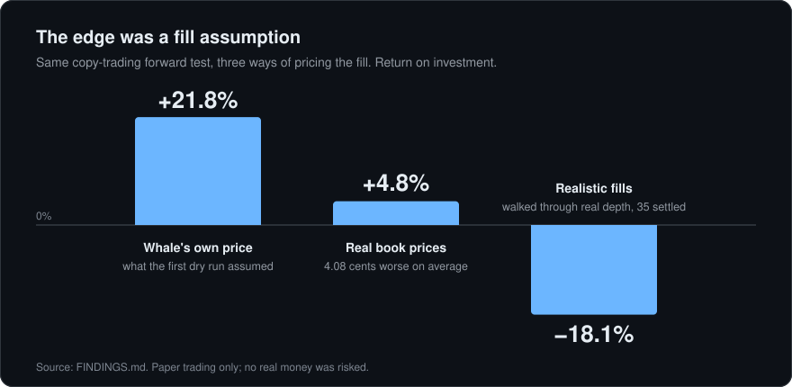

<div align="center">

# Polymarket Research Rig

### A copy-trading bot that tested its own idea to destruction, then kept testing.

*Real money risked: $0. Hypotheses rejected, with the numbers: nearly all of them. That was the point.*

<br/>

[](FINDINGS.md)
[](research/PREREG_llm_forward.md)
[](https://gaurangkhurana.ca)

<br/>

[](https://github.com/gkhurana21/polymarket-betting-bot/actions/workflows/ci.yml)


[The problem](#the-problem) • [Verdicts](#the-verdicts) • [Method](#the-method) • [Under the hood](#under-the-hood) • [Run it](#run-it)

</div>

---



> **Disclaimer:** This is research and paper trading only. Prediction markets involve financial risk and you can lose
> money. The code refuses to start with `dry_run: false` in the observation phase. Nothing here is financial advice.

## The problem

Polymarket publishes what its biggest traders buy. The obvious idea is to copy them. Paper results can look great and
still be wrong, because it is easy to assume you get the price the whale got.

## The fix

**Build the copy-trading bot, then try to break it.** The rig tracks whales, runs four paper-trade streams side by
side (with a random-side control), and settles every trade. When a result looked good, the next step was to check it
against real order books. When it died, the next hypothesis got the same treatment. Every verdict is written down,
including the ones that hurt.

<table>
<tr>
<td align="center" width="25%"><h3>11</h3><sub>trading hypotheses tested: 10 rejected with the deciding number, 1 pre-registered and pending</sub></td>
<td align="center" width="25%"><h3>21,243</h3><sub>resolved paper signals in the copy-trading test</sub></td>
<td align="center" width="25%"><h3>−18.1%</h3><sub>ROI of the live-path forward test with realistic fills (35 settled)</sub></td>
<td align="center" width="25%"><h3>$0</h3><sub>real money risked, over about 71 days of observation</sub></td>
</tr>
</table>

## The verdicts

Each row links to the file that holds the numbers. All of them are offline or read-only against public data.

| Hypothesis | Verdict | The number that decided it |
|---|---|---|
| **Copy whale trades** | Rejected | −18.1% ROI with realistic fills (35 settled), t ≈ 0. See [FINDINGS.md](FINDINGS.md) |
| **Complement arbitrage** (buy YES + NO under $1) | Closed, venue-wide | 0 of 908 markets, both directions. The pair sits one tick (0.001) from $1, because split/merge pins it. See [thin markets](research/FINDINGS_thin_markets.md) |
| **Favourite-longshot bias** | Rejected | Realised frequency tracks the ask across 2,379 resolved markets. The one survivor has t = 0.91 and flips sign by slice. See [longshot](research/FINDINGS_longshot.md) |
| **Friday market making** (liquid markets) | Rejected | Liquidity rewards covered 17% of measured adverse selection. The bot is in [friday/](friday/README.md), its result in [friday/FINDINGS.md](friday/FINDINGS.md) |
| **Thin-market making** | Not tradeable | Markout is positive (+0.179c) but only +0.100c per fill, and 64% of markets are too one-sided to round-trip. See [thin markout](research/FINDINGS_thin_markout.md) |
| **LLM forecasting, no retrieval** | Rejected | Brier 0.1571 vs 0.1368 for the market on the same 220 markets. See [LLM](research/FINDINGS_llm.md) |
| **Sports models** (draw bias, Poisson) | Rejected | Draw bias: +1.88% in-sample, −12.88% out-of-sample. Poisson Brier 0.1576 vs 0.1497 for the market. See [sports](research/FINDINGS_sports.md) |
| **Exclusive-outcome sums** | Rejected | Real violations (2 of 216), but a per-leg fee made both net negative. See [exclusive](research/FINDINGS_exclusive.md) |
| **Two-leg monotonicity** | Rejected | Real violations with depth, but 1.17% annualised on $7,299 of capital. See [monotonicity](research/FINDINGS_monotonicity.md) |
| **Cross-venue arbitrage** (Polymarket vs Kalshi) | Rejected | Real gaps on 18 matched pairs, but the best pays ~10% annualised with capital locked for months, against 4–5% from T-bills. See [cross-venue](research/crossvenue/FINDINGS.md) |
| **LLM with search (H005)** | **Pending** | Pre-registered. Scored on or after 2026-11-21 |

### Three results worth the read

**The edge was a fill assumption.** The first dry run filled every order at the whale's own price. Against real order
books the obtainable price was on average 4.08 cents worse. Recomputing at real prices took the forward test from
+21.8% to +4.8%, and modelling fills properly took it to −18.1%. A 59% win rate still lost money, because wins on
heavy favourites pay pennies and one loss erases twenty.

**Speed was not the constraint.** The detection lag (p50 about 47 minutes) comes from Polymarket's public data API.
The tempting fix is a faster on-chain watcher. The data says no: filled at about the whale's price, 26 orders still
returned −22.9% ROI. Only 29% of signals filled (38 of 129), and those fills skew toward trades we should not take.

**Six studies searched under the streetlight.** The filters kept 75 of 2,100 open markets, which is 3.6% of the venue.
Complement arbitrage was retested on the 466-market middle band, with the same answer. The scope error is written up
in [FINDINGS_thin_markets.md](research/FINDINGS_thin_markets.md), next to the fix.

## The method

The rig was built so a wrong answer is hard to produce quietly.

* **Realistic fills.** Prices are ask-side VWAP walked through real book depth. Midpoints and last trades are not
  prices you can buy at. Wide books (a stub bid 0.001 and ask 0.998) are filtered, because one fabricated a t = −3.31.
* **A control stream.** `null_random_side` picks YES or NO at random, so "the whale won" has something to beat.
* **Time-split validation.** Findings are checked out of sample. A +7.5% mid-band result later turned out to be an artifact.
* **Pre-registration.** The H005 rules, the declared defects, the decision rule and the scoring date were all committed
  before any market resolved. The git history is the timestamp.
* **Disagreeing statistics are bugs.** In the thin-market study the mean (−1.839c), median (+0.050c) and share-weighted
  (+1.864c) markout disagreed in sign. That exposed a token mix-up that had produced a confident, wrong, opposite result.
  After the fix the three agree.
* **Bugs are listed with the findings.** Wrong order sides, shares passed as USD, a drawdown guard that blocked 687 of
  688 valid intents, and a Gamma filter that silently returns unrelated markets. All caught in dry run.

### H005: a forecast test that can fail in public

H005 asks whether an LLM with live search beats the market. It stored 124 forecasts on 2026-09-24
(`gemini-3.1-pro-preview`, Google Search grounding, temperature 0). The rules are in
[PREREG_llm_forward.md](research/PREREG_llm_forward.md), and the scoring date is in
[SCORING_DATE_llm_forward.md](research/SCORING_DATE_llm_forward.md).

* The pre-registration declares four known defects up front. The market price leaked through search on 87 of 124
  rows. 112 rows depend on US midterm results, so the effective sample is a handful of events.
* **Primary test:** mean squared-error difference against the market, cluster bootstrap, 10,000 resamples, seed fixed.
* **The expected verdict is "not demonstrated."** The test runs anyway because it is nearly free, and it is publishable
  either way.
* **Status:** 112 of 122 primary rows had resolved by 2026-11-12. No interim score has been computed or looked at.

## Under the hood

```text
whale poll (60 s) ──> signals ──> paper_consumer ──> four streams ──> resolution poll ──> decision matrix
market scan (10 min) ──> snapshots + book depth ──────────────────────────^
research/*.py ──> read-only studies on the stored corpus and public endpoints ──> FINDINGS_*.md
```

| Piece | What it does |
|---|---|
| `bot/whale_tracker.py`, `bot/whale_perf.py` | Poll tracked wallets, classify open / add / exit / flip signals, keep a Beta trust score per whale |
| `bot/paper_trader.py` | Fan each signal out to four streams: `copy_whale`, `stub_blend`, `null_random_side`, `whale_side_random_timing` |
| `bot/calibration.py` | Readiness gate and decision matrix (`HALT`, `INCONCLUSIVE`, `BUILD_B_RELAXED`, `BUILD_B_FULL`) |
| `bot/client.py` | CLOB wrapper with retry and a circuit breaker |
| `bot/tracker.py` | SQLite in WAL mode, an append-only audit log, settlement |
| `bot/arbitrage_scanner.py` | Observation-only complement scanner with an explicit fee and slippage model |
| `bot/executor.py`, `bot/risk.py` | Phase B order path with realistic fill modelling and position, drawdown and size guards |
| `research/` | The study scripts and the findings they produced |
| `research/crossvenue/` | Polymarket vs Kalshi: question matching, a validated LLM adjudicator for matched pairs, spread and annualised-return scoring |
| `friday/` | Friday, a liquidity-rewards market maker: reward-band quoting, inventory and guard limits, a replay harness, a thin-market scanner, and its own tests |

Numbers: about 6,600 lines in `bot/`, about 3,200 in `research/` (crossvenue included), about 4,100 in `tests/`, and about 3,400 in `friday/` (550 of them tests). Python, SQLite, `scipy`
for the z-test and Fisher's exact test, and `rich` for the CLI.

**Tests.** `pytest` runs 23 tests offline, and CI runs them on every push: 15 smoke scripts in `tests/` (modules 1 to
12, the opportunity funnel, the LLM forecaster and the forward scorer) and Friday's 8 test modules. Each is a plain
script that asserts as it goes, run in its own process on synthetic books and a temporary SQLite file. Three checks
that call Polymarket itself are skipped offline (`LIVE_API_TESTS=1` turns them on). The contamination-detector test
and one block of the scorer test read the stored corpus in `data/`, which is not in the repo, so a fresh clone and CI
skip those: 22 pass and 1 is skipped there.

**Fees.** Polymarket charges takers `C × feeRate × p × (1 − p)` and never charges makers. A smoke test checks the code
against the published table at p = 0.01, 0.05, 0.50 and 0.95.

## Run it

Python 3.10+ is required.

```bash
python3 -m venv .venv && source .venv/bin/activate
pip install -r requirements.txt
cp .env.example .env          # CLOB keys are optional for public reads. Leave PRIVATE_KEY unset.
```

Keep `dry_run: true` and `phase: A` in `config.yaml`. With `dry_run: false` the observation phase refuses to start.

```bash
python main.py scan                  # one-shot market scan
python main.py serve                 # the observation daemon (Ctrl+C to stop)
python main.py status                # readiness counters and decision matrix
python main.py whales                # whale trust scorecard
python main.py pnl --days 7          # P&L per stream
python main.py arb-scan              # one read-only complement arbitrage pass
python main.py arb-status --days 7   # frequency, capacity, edge, rejections
```

Run the tests, one smoke script, or a study:

```bash
pytest -q                                   # all 23, offline
.venv/bin/python tests/smoke_module12.py
python3 research/longshot_study.py --buffer-hours 6 --max-spread 0.05
```

`data/trades.db` is the paper-trade store and `data/audit.log.jsonl` is the audit log. Run only one `serve` per
database. The full architecture and schema are in [PLAN.md](PLAN.md), and the daemon's day-one notes are in
[OBSERVATIONS.md](OBSERVATIONS.md).

## Limits, honestly

* **No edge was found.** The repo's headline is a negative result. The reusable part is the harness, not a strategy.
* **The studies are offline and in sample where noted.** Several rest on small samples (n = 32 for the bookmaker
  comparison, 35 settled live-path orders). Those are marked as directions in the findings, not verdicts.
* **The H005 result is expected to be weak.** The sample is one correlated midterm event, and the prompt leaked the
  market price. A rerun would need the fixes listed in the pre-registration.
* **A real sports-model test is blocked on data.** It is not closed.
* **Phase B was never run.** The live order path exists, was exercised only in dry run, and `PRIVATE_KEY` was never set.
  No wallet was funded.
* **Some scripts are research code.** They read `/tmp` inputs and live endpoints, so a few cannot be rerun as is.
* **The whale daemon no longer runs as is.** Polymarket retired the Data API v1 and leaderboard endpoints it polls
  (HTTP 410 on 2026-11-19). `serve` and `whales` would need porting to Data API v2. The market scanner and the
  order-book studies use the CLOB and Gamma APIs, which still answer.
* **One bug was never fixed.** The whale universe is frozen at daemon startup. See the 2026-06-03 entry in
  [OBSERVATIONS.md](OBSERVATIONS.md).

## License

MIT. See [LICENSE](LICENSE).
