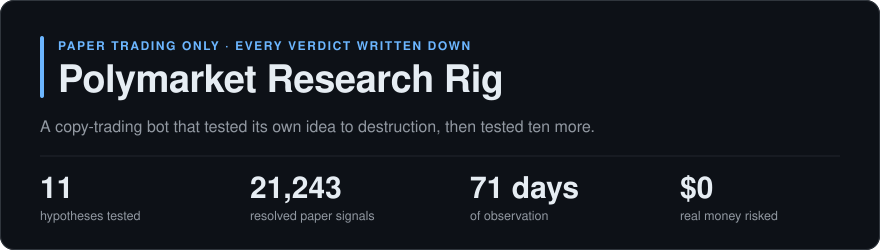
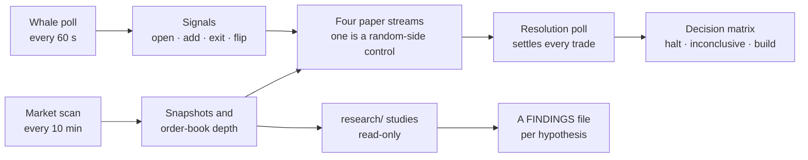
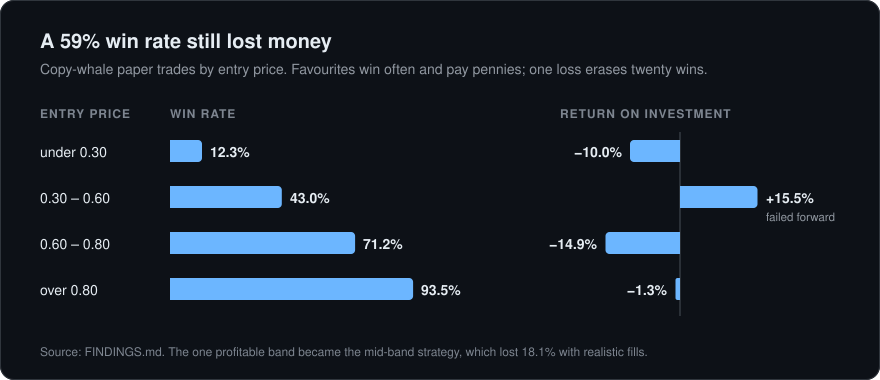

<h1 align="center">
  
</h1>

<p align="center">
  <a href="https://github.com/gkhurana21/polymarket-betting-bot/actions/workflows/ci.yml"></a>
  
  
  
  <a href="LICENSE"></a>
</p>

<p align="center">
  <a href="#what-was-tested"><b>Verdicts</b></a> ·
  <a href="#what-is-proven"><b>Method</b></a> ·
  <a href="#h005-a-forecast-test-that-can-fail-in-public"><b>H005</b></a> ·
  <a href="#what-is-not-claimed"><b>Limits</b></a> ·
  <a href="#run-it"><b>Run it</b></a> ·
  <a href="FINDINGS.md"><b>Full findings</b></a>
</p>

**A copy-trading bot for Polymarket that was built to test its own idea, found the idea does not work, and then tested ten more the same way.** Every verdict is written down with the number that decided it, including the ones that hurt. Paper trading only: no order was ever sent and no money was risked.

<p align="center">
  
</p>

<p align="center"><i>The first dry run reported +21.8%. The only thing that changed between the three bars is how honestly the fill was priced.</i></p>

## What it is

A research harness around Polymarket's public APIs, and the record of what it found.

1. A daemon polls the wallets at the top of Polymarket's leaderboard and classifies each trade as an open, add, exit or flip.
2. Every signal becomes four paper trades side by side: copy the whale, a blended variant, the whale's side at a random time, and a **random side** as the control.
3. A scanner stores market snapshots and order-book depth, so a paper fill can be priced by walking the real book rather than assumed.
4. A poller settles every trade when its market resolves, and a decision matrix says whether the evidence supports going further.
5. When copy-trading failed, the stored corpus and the same rules were used to test ten more hypotheses. Each finished one has a findings file with the number that decided it.

Two things sit beside the daemon: [`friday/`](friday/README.md), a liquidity-rewards market maker that was built and then measured against its own costs, and [`research/`](research), the study scripts.



## What was tested

| # | Hypothesis | Verdict | The number that decided it | Write-up |
|---|---|---|---|---|
| 1 | **Copy whale trades** | Rejected | −18.1% ROI with realistic fills (35 settled), t ≈ 0 | [FINDINGS](FINDINGS.md) |
| 2 | **Complement arbitrage**: buy YES + NO under $1 | Closed, venue-wide | 0 of 908 markets. Split and merge pin the pair one tick from $1 | [thin markets](research/FINDINGS_thin_markets.md) |
| 3 | **Favourite-longshot bias** | Rejected | Realised frequency tracks the ask across 2,379 resolved markets | [longshot](research/FINDINGS_longshot.md) |
| 4 | **Market making for liquidity rewards** | Rejected | Rewards covered 17% of measured adverse selection | [Friday](friday/FINDINGS.md) |
| 5 | **Thin-market making** | Not tradeable | +0.100c per fill, and 64% of markets are too one-sided to round-trip | [thin markout](research/FINDINGS_thin_markout.md) |
| 6 | **LLM forecasting, no retrieval** | Rejected | Brier 0.1571 against the market's 0.1368 on the same 220 markets | [LLM](research/FINDINGS_llm.md) |
| 7 | **Sports models**: draw bias, Poisson | Rejected | Draw bias +1.88% in sample, −12.88% out of sample | [sports](research/FINDINGS_sports.md) |
| 8 | **Exclusive-outcome sums** | Rejected | 2 real violations in 216, both net negative after the per-leg fee | [exclusive](research/FINDINGS_exclusive.md) |
| 9 | **Two-leg monotonicity** | Rejected | Real violations, but 1.17% annualised on $7,299 of capital | [monotonicity](research/FINDINGS_monotonicity.md) |
| 10 | **Cross-venue arbitrage**: Polymarket vs Kalshi | Rejected | Best of 18 matched pairs pays ~10% annualised, locked for months | [cross-venue](research/crossvenue/FINDINGS.md) |
| 11 | **LLM with live search (H005)** | **Pending** | Scored on or after 2026-11-21 | [pre-registration](research/PREREG_llm_forward.md) |

Several of these found something real: actual constraint violations, positive markout, genuine price gaps between venues. Those were rejected on what it would pay after fees, fills and locked capital, not on whether the effect exists.

Three of these are worth reading in full.

**The edge was a fill assumption.** The first dry run filled every order at the whale's own price. Against real order books the obtainable price was on average 4.08 cents worse. Recomputing at real prices took the forward test from +21.8% to +4.8%, and modelling fills properly took it to −18.1%. A 59% win rate still lost money, because wins on heavy favourites pay pennies and one loss erases twenty.

<p align="center">
  
</p>

**Speed was not the constraint.** The detection lag (p50 about 47 minutes) comes from Polymarket's public data API. The tempting fix is a faster on-chain watcher. The data says no: filled at about the whale's price, 26 orders still returned −22.9% ROI. Only 29% of signals filled (38 of 129), and those fills skew toward trades we should not take.

**Six studies searched under the streetlight.** The filters kept 75 of 2,100 open markets, which is 3.6% of the venue. Complement arbitrage was retested on the 466-market middle band, with the same answer. The scope error is written up in [FINDINGS_thin_markets.md](research/FINDINGS_thin_markets.md), next to the fix.

## What is proven

Not that a strategy works. What is shown is that the rig makes a wrong answer hard to produce quietly.

| Claim | Evidence |
|---|---|
| Fills are priced at what the book would have given | Ask-side VWAP walked through stored book depth, never a midpoint or last trade. Wide books (a stub bid at 0.001 and ask at 0.998) are filtered, because one fabricated a t = −3.31 |
| "The whale won" has something to beat | The `null_random_side` stream takes the same signals and picks YES or NO at random |
| Results are checked out of sample | A +7.5% mid-band result on a time split later turned out to be an artifact, and is reported as one |
| The H005 rules were fixed before any outcome | The rules, four declared defects, the decision rule and the scoring date were committed before any market resolved. The git history is the timestamp |
| Disagreeing statistics are treated as bugs | In the thin-market study the mean (−1.839c), median (+0.050c) and share-weighted (+1.864c) markout disagreed in sign. That exposed a token mix-up behind a confident, wrong, opposite result. After the fix the three agree |
| The fee model is Polymarket's own | Takers pay `C × feeRate × p × (1 − p)` and makers pay nothing. A test checks the code against the published table at p = 0.01, 0.05, 0.50 and 0.95 |
| The tests run on every push | `pytest` runs 23 tests offline: 15 smoke scripts and Friday's 8 test modules, each in its own process on synthetic books and a temporary SQLite file. In CI, 22 pass and 1 is skipped because it needs the stored corpus |

Bugs are listed with the findings rather than hidden: wrong order sides, shares passed as USD, a drawdown guard that blocked 687 of 688 valid intents, and a Gamma filter that silently returns unrelated markets. All were caught in dry run.

## H005: a forecast test that can fail in public

H005 asks whether an LLM with live search beats the market. It stored 124 forecasts on 2026-09-24 (`gemini-3.1-pro-preview`, Google Search grounding, temperature 0). The rules are in [PREREG_llm_forward.md](research/PREREG_llm_forward.md), and the scoring date is in [SCORING_DATE_llm_forward.md](research/SCORING_DATE_llm_forward.md).

- The pre-registration declares four known defects up front. The market price leaked through search on 87 of 124 rows. 112 rows depend on US midterm results, so the effective sample is a handful of events.
- **Primary test:** mean squared-error difference against the market, cluster bootstrap, 10,000 resamples, seed fixed.
- **The expected verdict is "not demonstrated."** The test runs anyway because it is nearly free, and it is publishable either way.
- **Status:** 112 of 122 primary rows had resolved by 2026-11-12. No interim score has been computed or looked at.

## What is not claimed

**No edge.** The headline is a negative result. The reusable part is the harness, not a strategy.

**No live trading.** The order path exists and was exercised only in dry run. `PRIVATE_KEY` was never set and no wallet was funded. The observation phase refuses to start with `dry_run: false`. Nothing here is financial advice.

**Not every verdict is strong.** Several studies rest on small samples (n = 32 for the bookmaker comparison, 35 settled live-path orders) or are in sample where noted. The findings mark those as directions, not verdicts.

**The H005 result is expected to be weak.** The sample is one correlated midterm event, and the prompt leaked the market price. A rerun would need the fixes listed in the pre-registration.

**The sports-model question is not closed.** A real test is blocked on data.

**Not all of it can be rerun.** The stored corpus (`data/`) is not in the repo. Some research scripts read `/tmp` inputs and live endpoints. And Polymarket has since retired the Data API v1 and leaderboard endpoints the whale daemon polls (HTTP 410 on 2026-11-19), so `serve` and `whales` would need porting to Data API v2. The market scanner and the order-book studies use the CLOB and Gamma APIs, which still answer.

**One bug was never fixed.** The whale universe is frozen at daemon startup. See the 2026-06-03 entry in [OBSERVATIONS.md](OBSERVATIONS.md).

## Run it

Python 3.10 or later.

```bash
python3 -m venv .venv && source .venv/bin/activate
pip install -r requirements.txt
pytest -q                                   # all 23 tests, offline
```

To run the tools, copy `.env.example` to `.env` (the CLOB keys are optional for public reads; leave `PRIVATE_KEY` unset) and keep `dry_run: true` and `phase: A` in `config.yaml`.

```bash
python main.py scan                  # one-shot market scan
python main.py status                # readiness counters and decision matrix
python main.py pnl --days 7          # P&L per stream
python main.py arb-scan              # one read-only complement arbitrage pass
python main.py arb-status --days 7   # frequency, capacity, edge, rejections
python main.py serve                 # the observation daemon (needs the retired Data API v1; see above)
python3 research/longshot_study.py --buffer-hours 6 --max-spread 0.05
```

`data/trades.db` is the paper-trade store and `data/audit.log.jsonl` is the audit log. Run only one `serve` per database.

## Layout

```
bot/                 the daemon: whale tracker and trust scores, four-stream paper trader, market scanner,
                     CLOB client with retry and a circuit breaker, SQLite tracker and audit log, the
                     readiness gate, the complement-arbitrage scanner, and the dry-run order path
research/            the study scripts and a FINDINGS file for each hypothesis
research/crossvenue/ Polymarket vs Kalshi: question matching, an LLM adjudicator for matched pairs, scoring
friday/              the liquidity-rewards market maker, its replay harness, its tests and its findings
tests/               15 smoke scripts, and test_smoke.py, which runs them and Friday's tests under pytest
docs/                the chart above
FINDINGS.md          the copy-trading verdict
PLAN.md              the full architecture and schema
OBSERVATIONS.md      the daemon's running notes
```

About 6,600 lines in `bot/`, 3,200 in `research/`, 4,100 in `tests/` and 3,400 in `friday/`. Python, SQLite, `scipy` for the z-test and Fisher's exact test, and `rich` for the CLI.

## License

[MIT](LICENSE).
